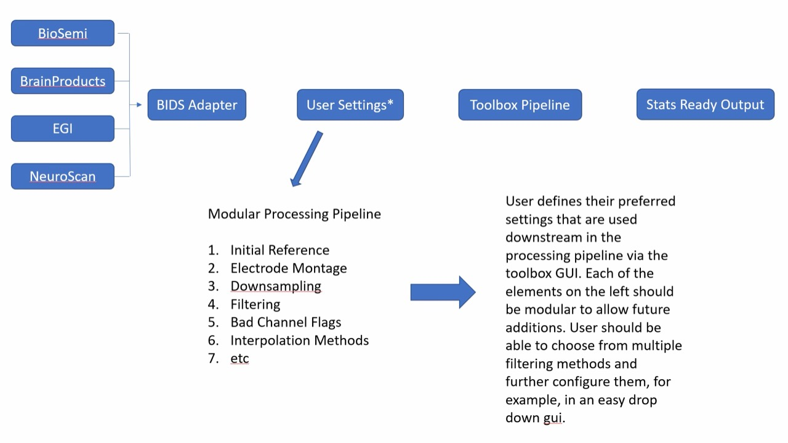
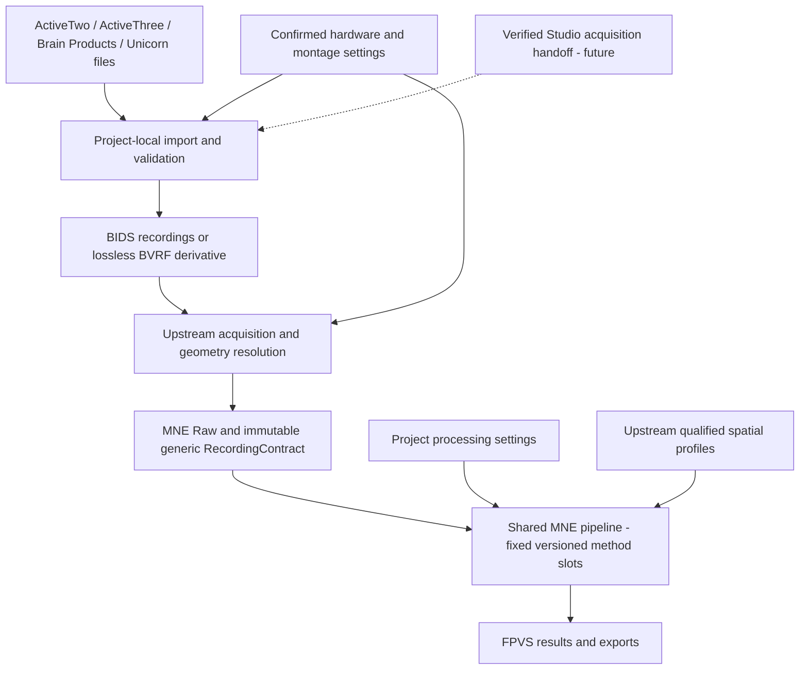

# Hardware, Processing, and FPVS Studio Direction

Status: current implementation and product direction, updated 2026-10-19 for
`codex/multi-hardware-bids` and its upstream acquisition adapters.
This page separates the current implementation from the intended future state.
It guides scoped implementation plans; it does not enable new hardware or change
scientific methods by itself. Read it when changing acquisition, montages,
processing composition, project import, or Studio interoperability.

## Product priority and maintainer reference

The maintainer clarified on 2026-10-19 that **the processing pipeline is the
primary product**. Toolbox should become a modular EEG processing package
supporting many hardware configurations, with processing methods and parameters
chosen by users and saved per project. Correct, reproducible processing and
stats-ready output take priority over additional analysis and visualization
features. FHC, scalp maps, and the other tools are secondary add-ons that make
working with those outputs easier. Their execution must not be a prerequisite
for using the processing pipeline. This is product direction, not a claim that
the current application already has an independently packaged plugin system.

The original user-supplied diagram is preserved without alteration:

Interpret the diagram as a future architecture and UX reference:

- Native hardware/file adapters feed the shared MNE processing boundary through
  the BIDS import layer. ActiveTwo, ActiveThree, Brain Products, and Unicorn have the scoped routes below;
  EGI and NeuroScan in this diagram are target families, not enabled support.
  The documented lossless BVRF derivative exception still applies.
- Each project's users choose supported modules, methods, and parameters for
  referencing, montage handling, resampling, filtering, bad-channel detection
  or flags, interpolation, and future steps. Hardware/montage capabilities
  determine which choices are valid; they do not replace user analysis choices.
- The GUI should expose concise method selectors with relevant configuration
  controls, such as a filter-method dropdown and settings for that method.
  Keep advanced controls contextual rather than cluttering the main window.
- The diagram's numbered list names configurable areas; it is **not an
  executable stage order**. It does not authorize changing the current locked
  filter-before-downsample sequence. Future method/order alternatives need
  explicitly versioned profiles, validation, and scientific contract updates.

Save the original reference alongside the [editable implementation map](figures/canonical-eeg-recording.mmd),
which separately records the current import/shared-pipeline boundary. Do not
silently turn aspirational boxes into current support claims.

## Current implementation

| Area | Implemented boundary | Still to do |
| --- | --- | --- |
| Production acquisition | Confirmed ActiveTwo64 BDF, ActiveThree BDF, Brain Products BVCDF/BVRF, and Unicorn raw BDF/continuous BDF+ enter the common BIDS and MNE boundary. Project hardware, mappings and method choices persist. | Validate representative laboratory recordings and visible acceptance before release; qualify additional montage-specific tools separately. |
| Acquisition definitions | `io.acquisition_metadata` resolves the four routes into immutable `io.recording_contract.RecordingContract`; `io.geometry_metadata` owns source/expected geometry identity. `io.acquisition_profiles` owns the explicit Unicorn profile and inspection definitions. | Extend scoped adapters and declared capabilities without inventing supported formats or hardware. |
| ActiveThree | Explicit project identity, recorded/selected-template geometry, channel-role overrides, and recorded/selected-channel reference. No inherited 64-channel limit or calibrated spatial QC. | Qualify physical recordings and additional auxiliary/multi-subject configurations; sharing BDF does not imply ActiveTwo64 geometry. |
| Unicorn | Production BIDS admission reuses the reviewed units/grid reader, exact marker semantics and explicit mapping. The generic contract requires eight channels, native 250 Hz, average reference and no resampling/interpolation. Standalone inspection evidence still retains `scientific_processing_allowed=False`. | Resolve the [Unicorn plan's](../exec-plans/active/unicorn-hybrid-black-support.md) physical amplitude, reference, wireless-loss and stimulus-timing evidence. Software processing is not hardware qualification. |
| Brain Products | Shared discovery/loading/preflight/pipeline/export routes accept BVCDF and single-participant BVRF 1.0.0. Project hardware, reference, channel roles, and selected montage persist. See [scope and sources](../../user/reference/brain-products.md). | Historical formats, multi-participant BVRF splitting, hardware gain/latency qualification, and BioSemi-specific statistical/spatial capability qualification remain separate work. |
| BIDS admission | `io.bids_import` / `bids_loader` publish project-local BDF/BVCDF datasets and a lossless BVRF derivative, returning MNE Raw through common full/lazy/prefetch reads. Unicorn preserves original BDF plus the narrowly normalized unit-header copy and unchanged packed samples. | External BIDS study import/export, additional source formats, and laboratory acceptance remain separate work. |
| Processing | Shared MNE stages consume generic recording metadata and project settings through 19 fixed versioned method slots. Per-project selections, checkpoints and exports share method identity; current algorithms and historical default fingerprints are preserved. Hardware defaults and geometry qualification remain upstream. | Qualify alternative algorithms and add compact method selectors with their parameter controls. Arbitrary reordering is unsupported. |
| Studio project import | `Main_App.projects.fpvs_config_import` accepts `.fpvsconfig` schemas 1.0.0–1.8.0 for FPVS Oddball and Cognitive Load FPVS, importing the Toolbox-owned project/protocol/marker and optional removed-electrode subset. | Verify complete field and workflow coverage against explicitly identified Studio versions and real, sanitized exports. Current import is not complete Studio compatibility. |
| Studio acquisition evidence | `Main_App.io.studio_acquisition_evidence` validates a candidate handoff and compares ordered trigger codes only after reviewed recording association. | Qualify receiver integration, recording identity, acquisition facts, and timing semantics. Code agreement alone does not prove sample timing or recording completeness. |
| Updates | The independent updater uses ported Studio design/contracts with Toolbox-specific application and installer identities. | Maintain versioned protocol parity where intended. Updater similarity does not establish experiment/data interoperability. |

Runtime acquisition resolution uses `projects.hardware`,
`io.acquisition_metadata`, and the I/O geometry adapters. The immutable
`RecordingContract` carries resolved channel/reference/event semantics,
geometry identity, historical fingerprints, and capabilities.
`processing.acquisition_policy` is retained only as a compatibility import shim.
The immutable `io.acquisition_profiles` registry owns the explicit Unicorn
acquisition definition and BioSemi/Unicorn inspection contracts. It does not
resolve arbitrary recording montages or establish physical qualification.

Evidence owners: [EEG loading](eeg-loading-contract.md),
[preprocessing](preprocessing-contract.md), [project I/O](project-io.md),
[updater](updater.md), and the corresponding `tests/project_io/`,
`tests/processing/`, and `tests/updates/` coverage. These describe the working
source tree; a release tag and its acceptance receipt define shipped behavior.

## Intended conceptual map: canonical EEG recording

Updated 2026-10-19 for `codex/multi-hardware-bids`. The import boundary,
upstream acquisition resolution, and shared numerical pipeline below are
implemented for the four scoped routes above. The dashed Studio acquisition
handoff remains a future verified integration; arbitrary hardware and montages
are not implied.
The [editable Mermaid figure](figures/canonical-eeg-recording.mmd) and this
embedded copy must remain synchronized.

`io.bids_import` publishes content-verified datasets inside the active project;
`io.bids_loader` admits them into the common full/lazy/prefetch loader. BDF
samples for the BioSemi routes are copied byte-for-byte. BrainVision Core signal bytes are unchanged,
with companion links relocated. MNE-BIDS 0.16 reads these normalized datasets.
Original annotations, subject metadata, events, units and geometry evidence are
preserved. Unicorn retains original source bytes plus a normalized BDF copy;
only the reviewed `?V` unit-header exception changes, with packed samples exact.
Import does not filter, resample, rereference, or interpolate.

BVRF is an explicit precision exception: original companions are retained in
`sourcedata` and calibrated samples are saved as a lossless FIF64 derivative.
That derivative is not standard raw EEG-BIDS, and must not be advertised as
such. Both representations return MNE Raw to the same numerical pipeline.
See the [loading contract](eeg-loading-contract.md#shared-import-boundary).

`io.acquisition_metadata` resolves reference, channel selection/order, event
semantics, geometry and qualification into `io.recording_contract.RecordingContract`.
`io.geometry_metadata` resolves source and cohort expectations.
Numerical stages consume those facts and project settings without native-format
or manufacturer branches. The reference, filtering, resampling, interpolation,
and QC algorithms remain in processing; they were not moved into the importer.
Calibrated spatial QC receives an explicit upstream channel/coordinate profile
and remains qualified only for its existing montage. Historical brand names in
serialized method/schema identifiers remain opaque compatibility data so
existing scientific fingerprints and output identities do not change.

A readable file still cannot enable an unqualified interpolation, QC, or
source-estimation method. Hardware identity, file format, montage and analysis
policy remain separate concerns. The generic contract alone does not qualify
new manufacturers or turn project settings into a general pipeline editor.
Production routes require their own admission and preservation checks.

BIDS supplies standard dataset organization and metadata; it allows several
signal formats. Full external BIDS study ingestion/export and complete Studio
compatibility remain separately scoped features. The import cache supplements
original project recordings and does not replace `project.json` identity.
Sources: [EEG-BIDS specification](https://bids-specification.readthedocs.io/en/stable/modality-specific-files/electroencephalography.html),
[MNE-BIDS reader](https://mne.tools/mne-bids/v0.16/generated/mne_bids.read_raw_bids.html),
and [MNE precision documentation](https://mne.tools/1.9/documentation/implementation.html#floating-point-precision).

The [initial comparison plan](../exec-plans/active/bids-shared-pipeline.md)
records the five-participant old/new preservation check. The
[multi-hardware plan](../exec-plans/active/multi-hardware-bids.md) records the
subsequent admission/pipeline matrix and its limits. Laboratory recordings,
enabled-QC workflows and visible GUI acceptance are separate evidence.

## Target: modular hardware and montages

Support different acquisition systems and electrode layouts through shared,
explicit contracts. Hardware identity, file format, montage geometry, channel
label mapping, reference policy, and trigger decoding are separate concerns.
Do not infer one from a filename, channel count, or another device's defaults.

Extend the existing registry and canonical owners before creating parallel
device-specific pipelines. A supported combination must declare its units,
sampling constraints, channel roles/order, geometry source and coordinate frame,
event authority, reference policy, and available capabilities. Device-specific
unit corrections and reader workarounds stay in focused I/O adapters.

Core montage support must cover project persistence, full/lazy/prefetch reads,
applicable QC, prepared-state/cache validation, processing, and exports.
Qualify secondary tools independently: unavailable ROI, plotting, clustering,
or source-estimation features must not block otherwise qualified core processing.
Keep unsupported add-on capabilities explicitly gated. Spatial interpolation,
sensor adjacency, source estimation, and montage-specific QC thresholds need
their own evidence. A generic channel list must not silently enable a
BioSemi64-only spatial method on another montage. Mixed acquisitions
within one project require explicit compatibility rules and recording-level
identity; their scientific comparability must not be assumed.

### Required Brain Products support

The maintainer wants broad Brain Products support and has not specified an
amplifier, cap, channel count, reference, or Recorder version. Do not select one
by assumption or require the user to know the model before planning the shared
architecture. Detect documented format/acquisition metadata where available;
request explicit montage/reference information only where it cannot be established.

The format inventory must cover BrainVision Core/Data Exchange recordings
(`.vhdr`, `.vmrk`, `.eeg`) and BrainVision Recording Format (BVRF: `.bvrh`,
`.bvrm`, `.bvrd`, optional `.bvri`), then assess documented legacy variants.
The vendor's [Core Data Format specification](https://www.brainproducts.com/download/specification-of-brainvision-core-data-format-1-0/)
and [BVRF documentation](https://www.brainproducts.com/support-resources/brainvision-recording-format/)
are the initial format references, checked 2026-10-18. BVRF conversion can omit
impedance and other metadata; conversion is not automatically a lossless
substitute for native support.

Keep companion-file identity, units/calibration, channel roles, acquisition and
analysis references, geometry, sampling, event types/sample positions and
discontinuities explicit. Reuse the shared pipeline and capability gates rather
than the BioSemi EXG-pair policy. Validate full/lazy reads, reviewed marker maps,
cache/resume, exports and eligible downstream tools with representative fixtures
for every claimed combination. Record direct support, validated conversion,
unqualified and unsupported cases separately. Broad family coverage is the
goal; it is not a promise that every unknown or historical file already works.

## Target: a composable processing pipeline

Resolve a deterministic processing plan from user-selected project methods
and parameters, the acquisition/montage contract, and versioned method policy.
The plan must support swapping, including, or omitting supported steps according
to project choices and device/montage requirements, without duplicating the
orchestration for each headset. Provide multiple supported implementations of
a step where qualified, such as different filtering or interpolation methods,
with method-specific configuration. The [method foundation](pipeline-methods.md)
now provides executable fixed slots and per-project versioned method selections
for the current algorithms, preserving legacy identities. Alternate algorithms
and their GUI selectors remain future work.

The initial **Settings > Processing > Guided setup** workflow now groups these
fixed slots into seven pages, with capability-aware controls and one final
review/save transaction. Direct Settings editing remains available. It provides
the extension point for future qualified method selectors without adding
controls to the main processing screen or allowing arbitrary stage reordering.
See the [current workflow and extension contract](pipeline-methods.md).

Persist the selected step/method identities, their versions and parameters, and
the resolved plan in the project, restoring them across application launches.
Keep existing projects' methods/results stable until the user explicitly changes
their configuration. Make the consequences of an edit clear, including which
processing outputs and dependent analyses need recomputation. Selecting another
hardware profile must not silently reset the project's analysis preferences or
substitute an incompatible method.

Each step needs a clear input/output contract, prerequisites, applicability,
method/version identity, and cancellation/error behavior. Distinguish required,
optional, and unsupported steps. Validate the whole plan before work starts;
report disabled or unavailable checks accurately. Reject incompatible settings
instead of silently substituting a reference, geometry, or scientific method.
Keep GUI controls driven by the resolved capabilities, compact and relevant to
the selected setup; execution remains in workers.

Persist enough resolved plan and acquisition identity to reproduce results and
invalidate stale checkpoints, caches, ledgers, and downstream artifacts when
the method or layout changes. Full processing, review preparation, resume,
condition repairs, and single-file/batch routes must use the same plan semantics.
Keep existing exported formats compatible; any necessary new provenance or
schema must be versioned with an explicit migration.

The existing BioSemi profile remains the regression baseline: initial reference,
drop reference channels, optional channel limit preserving stim, FIR filtering,
optional smart FFT Hann multi-notch filtering, downsampling,
kurtosis/interpolation according to reviewed settings, then final
average reference. Extracting this behavior into steps must preserve its order,
numerical values, FIR scaling, and fingerprints. A genuinely different method
requires a scoped scientific change, evidence, contract updates, and focused
tests. Pipeline modularity is not permission to reorder arbitrary operations.
The locked harmonic-selection profiles and independent FHC inference contracts
remain unchanged by acquisition refactoring.

## Target: complete FPVS Studio compatibility

The product goal is full compatibility across FPVS Studio's supported
experiment-to-analysis workflows, not only successful config parsing or updater
parity. Establish the exact Studio source/release and schema versions being
targeted before implementing an adapter. The current Toolbox tests specify its
accepted subset; they are not evidence that every current Studio export or
workflow is covered.

Maintain a compatibility matrix covering:

- Experiment categories, conditions, frequencies, recurrence, planned sequence
  counts/durations, trigger maps, and analysis-window semantics.
- Project, participant, group, session, run, and recording identities, including
  repeated sessions, exclusions, and manually removed electrodes where defined.
- Hardware/montage/reference declarations, channel roles, units, sampling,
  event sources, recording association, clock domains, discontinuities, and
  incomplete or failed acquisition evidence.
- Config, recording, and acquisition-sidecar schemas, required/optional fields,
  unknown versions, migrations, and any result handoff Studio actually defines.
  Determine the required direction for each exchange from the verified Studio
  contract; do not invent a reverse-import or result format.
- User workflow from Studio export through Toolbox project creation, review,
  processing and analysis, including unsupported combinations and recovery.

For every matrix row, record the verified producer contract, Toolbox consumer,
support status, remaining gap, and a reproducible acceptance fixture. Preserve
relevant provenance without silently dropping required scientific metadata.
Unknown or conflicting scientific fields must be rejected or routed to explicit
review. Keep canonical project/group/recording identity in `Main_App.projects`;
an external handoff must not bypass project validation or overwrite decisions.
Do not copy stimulus assets, private recordings, or local participant records
into source control to demonstrate interoperability.

## Implementation sequence and acceptance

1. Inventory verified Studio contracts and hardware/montage capabilities; record
   gaps and unresolved evidence before claiming support.
2. Characterize the existing BioSemi behavior, then extract reusable step
   contracts and deterministic plan resolution while preserving that baseline.
3. Maintain the four implemented acquisition routes and extend formats through
   shared contracts. Use the multi-hardware synthetic matrix for software
   regressions; complete each new profile's acquisition evidence and laboratory
   acceptance separately before making physical qualification claims.
4. Generalize downstream capability checks, geometry/ROI/adjacency ownership,
   persistence, provenance, and cache identity; qualify each additional montage.
   Prove the extension boundary with a third synthetic profile/montage that
   reaches common production processing through registration and tests without
   another device branch in orchestration or scientific metric code. Existing
   third-profile inspection tests alone do not satisfy this gate.
5. Close the Studio compatibility matrix with sanitized cross-application
   fixtures, malformed/unsupported cases, and end-to-end workflow acceptance.

Each implementation slice needs a bounded active plan and focused regression
checks. Use `verify.py --scope project-io --tier focused` and
`--scope processing --tier focused` for the foundation, then affected tool/GUI
scopes and the repo precommit gate for runtime integration. Execute Qt only in
CI or an explicitly approved visible environment. Portable source tests,
scientific qualification, native installer checks, and human workflow review
are separate evidence; document which have actually passed.

Do not label a device, montage, or Studio version fully supported until every
applicable acceptance row is satisfied. Research or design evidence alone does
not enable runtime support, and a passing parser test does not qualify hardware
amplitude, wireless integrity, or physical stimulus-onset timing.
