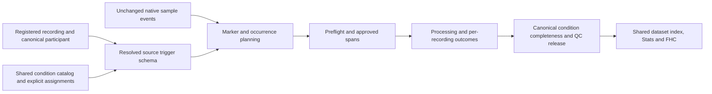

# Source trigger maps and independent participant identity

## Status and scope

Implementation complete, 2026-10-21. The versioned mapping model, durable source
participant identity, shared processing integration, source registration and
unified Home/Settings editor are implemented. The implementation-stage repository gate
passed: **8255 passed, 26 skipped**. Visible GUI acceptance remains deferred:
the user chose to continue processing and analysis without the GUI smoke check.
No offscreen Qt execution was used; registered Qt coverage remains a CI task.

### Current successor completion, 2026-10-22

Processing and statistical validation are complete for the revised SSD cohort:
**63 adults / 239 condition cells and 37 adolescents / 183 cells**. All 112
raw files retain their verified SHA-256 values. Independent validation passed
41,318 processing checks, 3,710 statistical checks, 7,192 source-BCA checks and
125 retry checks. The native ledger remains 422 ready and 138 excluded cells.

FHC used L2-normalized SNR and 10,000 permutations per condition in each of two
domains (100,000 evaluated assignments overall). The automatic domain contains
15 eligible harmonics through 21.6 Hz; the sensitivity domain fixes the original
six harmonics through 8.4 Hz. Below are native within-condition two-sided
cluster-family p values, without an additional five-condition Holm adjustment.

| Condition | Automatic domain p | Original six-harmonic domain p |
| --- | --- | --- |
| Negative Valence | 0.000400 | 0.090991 |
| Neutral Angry | 0.047995 | 0.654335 |
| Neutral Happy | 0.848315 | 0.367563 |
| Neutral Sad | 0.724928 | 1.000000 |
| Positive Valence | 0.002600 | 0.008999 |

Automatic-domain clusters favor adolescents for Negative Valence and Neutral
Angry; the latter is borderline and domain-dependent. Positive Valence favors
adults at 4.8 Hz in both domains. These are differences in relative normalized
response patterns, not absolute amplitudes or pointwise significance claims.
No fixed-five-harmonic BCA contrast passed the 15-test Holm family (minimum
adjusted p 0.053598, Neutral Angry / Central); the joint group-related model
block had Holm p 0.864249. P26's Negative Valence LOT summed BCA changed from
103.666622 to -0.161764 µV after the reviewed repair. These exploratory,
study-confounded comparisons establish neither causal age effects nor equivalence.

The current project-relative comparison bundle is
`3 - Statistical Analysis Results/Revised Cohort Comparisons/revised-cohort-20261022T171744637945Z/`.
Its completed `revised_analysis_summary_reconciled.json` has SHA-256
`0dcc7a5052649e2f21382dde399e8f01d376e7078722fe38a059f0286c7372d6`.
The completed offline report is
`3 - Statistical Analysis Results/Revised Cohort Report 20261022 Final/.data-app-offline/exports/adults-vs-adolescents-revised-report.html`
(SHA-256 `6931b41c600a902e1e63f237c960f3be47cb8978532b520033b119aeeace349b`).
Its build and 328 static/source/link checks passed. Browser-interactive visual
QA was unavailable after a security block and was not retried. All eight native
PNG/PDF map pairs passed actual PNG visual review, recorded in
`4 - Scalp Maps/Adults vs Adolescents/revised-scalp-maps-20261022T173340Z-9bf39874/root_actual_visual_review.json`
(SHA-256 `229f91a1bd5324841550ab32348f73e67d413e6d06c9982c4bb7545396508d88`).
The failed export attempt remains preserved.
An additive export correction and a 101-check dimension-aware assignment proof
validated unchanged actual permutation schedules; scientific settings and
results were not altered. The earlier snapshots below remain historical.

### Historical successor processing snapshot, 2026-10-22 16:52 UTC

The project now resides on the internal SSD and contains 112 explicit source
recordings, including seven subsequently admitted MCCTR recordings. Following
the user-authorized signal review, the frozen cohort contains 63 adults with
239 retained condition cells and 37 adolescents with 183 cells. A fresh native
run completed all 112 recording dispositions: 100 processed and 12 excluded.
The reconciled ledger contains **422 ready and 138 excluded cells**, with no
blocked, unavailable or partially retained cells.

Native finalization completed successfully, including QC20/QC21 release,
neutral FullFFT provenance, the unchanged three ROIs, the exploratory fixed
five-harmonic BCA list, and both analysis-ready exports. Adults use the exact
reviewed condition-local repair masks; adolescents retain their original QC
path. Independent checks passed for all 239 adult cells, and all 183 adolescent
cells match their original numerical exports exactly. No successor between-group
results are asserted here: final raw-byte verification, combined validation and
the new comparison report are pending at this processing-only snapshot.

The native review scanner now preserves exclusions across the entire configured
condition catalog, including conditions with no observed onset. This aligns
review evidence with production scope without changing samples or scientific
settings. The prior attempt and its receipts remain archived; the corrected
review identity received a fresh full native run. The repository gate after
this correction passed **8264 tests, with 26 skipped**.

Current project-local evidence is in
`Quality Check/MCCTR-revision-SSD-scope-correction-20261022/`, including
`frozen_cohort_decisions.json`, `scope_recovery_receipt.json`,
`native_processing_completion.json`, `finalize_processing_receipt.json` and
`repository_validation_after_scope_fix.json`. The analysis adapters and frozen
specification are staged there; the final report is not yet released.

### Historical original comparison, 2026-10-21

The following records the original cohort and results, before the subsequent
artifact investigation, adult signal reassessment and additional recordings.
These findings do not describe the current successor cohort.

The original comparison used 105 explicit recording assignments and five shared
conditions. Its EEG processing and independent output validation completed:

| Evidence | Verified result |
| --- | --- |
| Raw preservation | All 105 copied BDF files match their original verified copy SHA-256 receipts. |
| Eligible cohort | 74 distinct canonical participants: 37 adults and 37 adolescents, one session each. |
| Native outputs | 367 participant-condition outputs; three prior condition exclusions retained. |
| Recording exclusions | 31 excluded recordings in the native ledger: 27 manual-exclusion outcomes and four header-only outcomes. These outcome counts account for overlap in the original exclusion lists. |
| Independent validation | 18576 checks, zero failures. |
| Requested QC | Kurtosis was the only optional QC step. All detected candidates were automatically interpolated; 65 of 74 processed participants had at least one interpolated channel. No optional manual-review flags were introduced. |

Three shortened occurrences belonged to previously excluded conditions and
resolved through deterministic persisted-exclusion receipts, without creating
GUI review decisions. Source trigger codes, raw bytes, canonical participant
identity and mandatory timing/geometry/completeness guards were preserved.

Native finalization and both comparison workflows completed with exit code 0.
The original Dzhelyova/Poncet automatic harmonic rule selected no harmonics and
stopped standard harmonic finalization; its failure
receipt and original analysis plan are retained. The user then approved an
exploratory summed-BCA amendment using the previously inactive fixed list
**1.2, 2.4, 3.6, 4.8 and 7.2 Hz**. This is neither preregistered nor the active
prior source-study analysis. The amendment preserved numerical processing
identity, the completed processing ledger, QC settings and exclusions.

All 15 planned BCA condition-by-ROI contrasts were reportable. One passed the
native Holm family: Negative Valence, LOT, Adults minus Adolescents **+3.122 µV**
(ordinary 95% CI **1.163 to 5.081 µV**, Holm-adjusted p **0.026823**).
FHC independently selected **1.2, 2.4, 3.6, 4.8, 7.2 and 8.4 Hz** and completed
10,000 permutations for each of five conditions. None of its five global tests
passed the Holm family: adjusted p values were 0.108989 (Positive Valence),
0.180782 (Neutral Happy), 0.213579 (Negative Valence), and 1 (Neutral Angry and
Neutral Sad). These global tests are distinct from within-condition cluster
evidence; neither supports pointwise sensor/harmonic significance claims.

Independent result validation passed 4820 main checks and 63 supplementary
checks, with zero failures. All four native omnibus LRT blocks were
nonsignificant; the joint group-related block had raw p 0.219644 and Holm p
0.719496. Descriptive inspection found severe concentration in Negative Valence
LOT: the largest adult observation was 103.667 µV, versus 0.706 µV for the next
largest. Adult and adolescent medians were 0.151 and 0.514 µV, respectively,
opposite the fitted mean-contrast direction. No observations were removed or
models refitted. This does not establish model influence or robustness; native
convergence checks do not validate residual normality or homogeneous variance.
Study and age remain confounded; these are not causal age effects or equivalence.

After results were available, the user requested primary FHC reporting without
the additional across-condition Holm adjustment. The native within-condition
two-sided cluster permutation correction remains intact: Positive Valence at
4.8 Hz (p 0.021798) and Neutral Happy at 7.2 Hz (p 0.045195) each contain an
Adults-greater cluster. The original five-condition Holm results above remain
preserved and reported as secondary context. This is a reporting amendment,
not a rerun or pointwise significance claim. A bounded source-project check
found no readily identifiable RCADS/DSM-5 survey data. Future Spearman analysis
is recorded in `project.json` under `tools.analysis_notes.todos` and in a
readable project to-do file; no correlations were calculated.

Original-comparison evidence is recorded in `.codex-tmp/source-trigger-verified-precommit.log`
and the combined project's `logs/combination/processing_validation.json`,
`raw_unchanged_verification.json`, processing receipts, amended
`analysis_plan.json`, `fixed_harmonic_amendment_receipt.json`, completed
`finalize_processing_receipt.json`, and the comparison run's
`comparison_summary.json`, both independent analysis-validation receipts, and
`reporting_amendment_receipt.json`. The amendment retains the original plan/failure
artifacts and their hashes; raw files and source projects remain preserved.

The user requested per-group trigger mapping and explicitly confirmed that P1
in the adolescent source study and P1 in the adult source study are different
people. Expose convenient group setup, but bind acquisition interpretation to
explicit source protocols and recording identities. Biological group, source
study, participant, and trigger protocol are separate concepts.

Follow the existing [project I/O](../../architecture/project-io.md),
[loading](../../architecture/eeg-loading-contract.md),
[hardware/pipeline direction](../../architecture/hardware-pipeline-studio-roadmap.md),
[multi-group](multi-group-project-foundation.md),
[repeated-session](repeated-session-project-foundation.md), and
[guided setup](guided-pipeline-setup.md) contracts. Current code and current
project-I/O documentation include condition/recording-specific oddball markers;
older QC planning text that describes only a global oddball marker is historical.

## Historical baseline before implementation

The following records the initial planning baseline, not current limitations.
The identity, persistence, exclusions and trigger-map gaps described here are
addressed by the completed implementation and current architecture contracts.

- `projects/frequency_protocol.py` supports one project frequency/length
  protocol and project-, condition-, or recording-specific **oddball** markers.
  Every recording still shares one condition-onset `event_map`.
- `processing_controller.discover_raw_files()` honors an explicit participant
  registered against an exact raw path. Unregistered files infer IDs from
  filenames and can collide across groups.
- The combined project already has distinct canonical IDs `ACRP1` and
  `MCCTRP1`, both pointing to files named `p1.bdf` in different group folders.
  Preserve those IDs. No BDF rename is required.
- Participant normalization/persistence currently retains `group_id` and
  `raw_file`, but does not preserve a proposed source-study/local-ID payload.
- `processing/dataset_exclusions.py::_snapshot_from_manifest()` reparses raw
  filenames in its flat-project scan even when canonical registrations exist.
  This is a concrete integration gap: the two registered P1 files can still
  collide in the exclusions manager.
- Marker planning uses the next configured condition onset as a block
  boundary. Removing non-overlapping conditions from the configured onset set
  can therefore change which oddball markers belong to a selected block.

## Decisions

1. Preserve raw BDF bytes and native event codes, sample positions, and pulse
   semantics. Interpret them through a saved map; do not rewrite Status values.
2. Keep globally unique, stable participant IDs. Source-local P1 is a label,
   not a project-wide person key. Group membership never establishes identity.
3. Introduce stable canonical condition IDs only for explicitly opted-in mapped
   projects. Keep labels and existing output names, and preserve legacy projects
   without automatic rekeying, new defaults, or fingerprint changes.
4. Use named source trigger profiles with complete onset **and oddball** pairs.
   Resolve one immutable profile for each canonical recording/processing ID.
   Group defaults seed registration proposals; changing a group/default must
   not silently change an existing recording's interpretation.
5. Retain all recognized source condition boundaries, including conditions not
   selected for analysis. Boundary-only conditions produce no expected outputs.
6. The first release requires every selected condition in every assigned
   profile. An empty cell blocks setup; it is neither an exclusion nor zero.
   General not-collected/structurally missing group-condition designs are deferred.
7. Retain one project rate, oddball frequency, and analyzed-length protocol.
   This feature does not introduce group-specific timing or change preprocessing,
   harmonic selection, Stats, or FHC calculations.
8. Initially invalidate interpreted processing and downstream results across
   the project after a scientific map/catalog/assignment change. Targeted
   per-recording invalidation is a later optimization requiring separate proof.

## Implemented identity contract

| Concept | Adolescent example | Adult example | Rule |
| --- | --- | --- | --- |
| Source-study namespace | `acr` | `mcctr` | Stable identity independent of group label or folder name. |
| Original participant ID | `P1` | `P1` | Preserve exact source label, including leading zeros. |
| Canonical participant ID | `ACRP1` | `MCCTRP1` | Unique across the whole project; retain current IDs. |
| Display label | `ACR · P1` | `MCCTR · P1` | Presentation only; never a join or cache key. |
| Group ID | `adolescents` | `adults` | Canonical manifest assignment, independent of source identity. |
| Flat processing ID | `ACRP1` | `MCCTRP1` | Existing single-session convention. |
| Raw filename | `p1.bdf` | `p1.bdf` | Exact registered path resolves identity before filename inference. |

Persisted additive participant metadata: `source_study_id`,
`source_participant_id`, and optional `display_label`. A project-owned
`source_studies` registry supplies stable IDs and display names; optional source
manifest hashes/provenance describe origin without making an absolute source
path necessary to reopen a moved project. Do not repurpose the existing
`recording_sources.source_id`, which already identifies group/session input roots.

New registration must allocate and preview project-unique IDs before strict
processing discovery. Suggested names may use a source namespace, but allocation
must detect case-insensitive and sanitized-name collisions and persist the result
once. Do not reconstruct identity later by parsing a prefix or concatenating
group labels. A filename such as `ACR_P1.bdf` can still parse as P1 today.

Reuse one public registered-path/source-identity resolver across discovery,
repeated-session preflight, exclusions, review, and append registration. Keep
existing global duplicate guards; fix their inputs rather than relaxing them.
An existing registered participant ID is read-only during ordinary map editing.

Within a source study, explicitly registered repeated visits retain one canonical
participant and distinct recording IDs. Different source namespaces remain
independent even if local names or file hashes match. Automatic cross-study
same-person linking and rekeying processed participants are outside this scope.
Source study must not be represented as a session in a single-session project.

## Implemented trigger model and API

`Main_App.projects.condition_trigger_maps` owns immutable normalization,
validation, resolution, drafts, and semantic identity. Public APIs are exposed
through `Main_App.projects`; GUI and tool packages do not implement parallel
resolvers. `projects.raw_identity` owns registered-path identity and
`projects.source_registration` owns the prepare/review/atomic-append workflow.

Implemented interfaces:

- `project_conditions(project_or_manifest)` returns canonical condition IDs and
  labels for either legacy or mapped mode. Legacy adaptation is read-only.
- `resolve_recording_event_schema(context, processing_id)` returns canonical
  condition ID/label, actual onset/oddball codes, recognized boundary-only onsets,
  profile ID, recording ID, and interpretation fingerprint.
- `validate_project_trigger_maps(context)` checks catalog, assignment coverage,
  registered identities, profile completeness, code collisions, and timing policy.
- `TriggerMapDraft` stages catalog/profile/assignment changes and compares its
  manifest baseline before one atomic save.
- `resolve_registered_raw_identity(context, path)` supplies the existing canonical
  person/recording identity. `propose_source_participant_id(...)` and the source
  registration review allocate new identities without rekeying existing people.

The optional mapping extension is serialized inside frequency protocol version
**1.5.0**, including supported analyzed-window settings, so older Toolbox
versions reject the unsupported protocol before processing.
A top-level field alone is insufficient: old code may ignore it and use a stale
global map. Version-refusal behavior requires an executable regression.

Opt-in is one-way during ordinary editing in the first release. A mapped project
may assign the same profile to all recordings, but there is no toggle back to a
legacy global map. Any future reverse conversion must prove identical selected
onset/oddball semantics and preservation of all recognized source boundaries.

Illustrative extension for a **two-recording fixture**, not a complete project
manifest or a payload to inject into the current app:

```json
{
  "condition_trigger_maps": {
    "schema_version": "1.0",
    "canonical_conditions": {
      "neutral_angry": {"label": "Neutral Angry"},
      "neutral_happy": {"label": "Neutral Happy"},
      "neutral_sad": {"label": "Neutral Sad"},
      "positive_valence": {"label": "Positive Valence"},
      "negative_valence": {"label": "Negative Valence"}
    },
    "profiles": {
      "acr": {
        "conditions": {
          "neutral_angry": {"onset_code": 11, "oddball_code": 55},
          "neutral_happy": {"onset_code": 13, "oddball_code": 55},
          "neutral_sad": {"onset_code": 14, "oddball_code": 55},
          "positive_valence": {"onset_code": 21, "oddball_code": 55},
          "negative_valence": {"onset_code": 22, "oddball_code": 55}
        },
        "boundary_only_onset_codes": [12, 31, 41, 43]
      },
      "mcctr": {
        "conditions": {
          "neutral_angry": {"onset_code": 12, "oddball_code": 55},
          "neutral_happy": {"onset_code": 11, "oddball_code": 55},
          "neutral_sad": {"onset_code": 13, "oddball_code": 55},
          "positive_valence": {"onset_code": 1, "oddball_code": 55},
          "negative_valence": {"onset_code": 2, "oddball_code": 55}
        },
        "boundary_only_onset_codes": [3]
      }
    },
    "recording_assignments": {"ACRP1": "acr", "MCCTRP1": "mcctr"},
    "registration_group_defaults": {"adolescents": "acr", "adults": "mcctr"}
  }
}
```

Assignment keys use the existing flat processing ID or repeated-session recording
ID, according to canonical project context. Never use bare source P1, filename,
array position, or group label. The real combined project requires assignments
for its entire registered recording set, including currently excluded recordings.

In mapped mode, this catalog is authoritative; do not persist synthetic global
trigger codes. Migrate a legacy `event_map` only through explicit opt-in, retaining
labels/output names and an audit of the old map, then retire its active values.
Reject a conflicting nonempty legacy map. Update all direct readers through the
shared condition accessor or recording resolver, including project load/save,
Home conditions, guided setup, processing planning, and tool condition menus.

Mapped profiles are authoritative for oddball resolution too. Opt-in must resolve
the old project/condition/recording oddball settings into the appropriate profiles
and retire the competing active assignments. If recordings previously differ in
oddball schema, preserve that difference through explicit profiles. Do not silently
prefer one store over another. Legacy marker editors route to the unified editor
for mapped projects; legacy projects retain their existing workflow.

Validation rejects unknown IDs, incomplete selected-condition coverage, duplicate
onsets within a profile, boundary/selected overlap, local onset/oddball collision,
and unsupported code values for the admitted recording contract. Reusing a code
in different profiles is valid; sharing an oddball code across conditions is also
valid. Unknown observed codes remain diagnostic evidence and are not automatically
promoted to condition boundaries. Retain source labels for boundary-only codes in
editor/provenance metadata without using those labels as inference keys.

## Processing and persistence integration



Keep `condition_code` in existing per-recording evidence as the actual source
code; add canonical condition ID and map fingerprint rather than silently changing
that field's meaning. Expected-ledger joins use canonical condition identity and
recording ID, with source codes stored separately. Derive the existing per-file
`label -> source onset` adapter from the immutable resolved schema wherever a
numerical API needs it. Worker processes receive snapshots, not GUI state or
freshly inferred conventions.

| Owner | Implemented responsibility |
| --- | --- |
| `projects/frequency_protocol.py`, `condition_trigger_maps.py` | Versioned catalog/profiles, unified marker resolution, explicit assignments, validation and immutable snapshots. |
| `projects/project.py`, `grouping.py`, `recordings.py`, `recording_preflight.py`, public initializer | Persist/expose source identity, complete map coverage and conflict-safe registration; preserve legacy schemas. |
| `projects/raw_identity.py`, `source_registration.py`, `processing/processing_controller.py`, `processing/dataset_exclusions.py` | Share registered-path identity resolution and reviewed allocation; fix exclusion-manager filename re-inference. |
| `gui/processing_inputs.py`, `processing/preflight_qc.py`, `preflight_qc_plan.py` | Resolve per-recording schema before validation/loading plans; use the same source interpretation in Single and Batch. |
| `processing/marker_integrity.py`, `analysis_spans.py` | Preserve native codes and exact occurrence spans; include non-analyzed source onsets as boundaries. |
| `processing/kurtosis_review_scan.py`, `workers/kurtosis_review_process.py`, `workers/process_runner.py` | Carry the same snapshot through threaded/process scans, prepared data, epochs, restart and condition repair. |
| `processing/expected_processing_ledger.py`, `processing_ledger.py` | Canonical expected cells plus source receipts, one cohort protocol identity, freshness and release accounting. |
| `processing/preflight_qc_cache.py`, `preflight_qc_reuse.py`, `prepared_kurtosis_cache.py`, runner cache paths | Reject stale interpreted evidence; prove cold/warm/prepared-cache parity. |
| `processing/pipeline_settings_freshness.py`, `projects/pipeline_setup.py` | Preserve the extension in drafts, atomically commit changes and invalidate dependent results. |
| `processing/full_fft_provenance.py`, `exports/`, `projects/dataset_index.py` | Add interpretation provenance without changing existing output names/sheets; expose canonical identities consistently to tools. |
| Stats/FHC input adapters and condition menus | Use the shared catalog/index, preserve independent-person guards and existing statistical calculations. |

Scientific mapping/catalog/assignment edits make marker reviews, approved spans,
interpreted caches, processing outcomes, QC release, FullFFT provenance, canonical
harmonic selection, Stats, and FHC stale. Preserve raw-byte/event caches only when
their keys and payloads are source-only. Saving does not delete results or start
processing. First release may invalidate more than the affected recordings;
do not promise selective reuse while full-protocol fingerprints remain global.

Cosmetic source/profile display metadata and future-registration defaults should
not change current recording semantics. Keep them outside the scientific identity
projection and test that separation. Condition label edits can affect output
paths even when canonical IDs remain stable, so use explicit rename/staleness
handling. No-feature protocol payloads and hashes must remain exactly unchanged.
`FrequencyProtocol.to_manifest()` preserves the complete extension while
`canonical_payload()` uses its scientific projection. Cosmetic metadata and
registration defaults are retained on disk and excluded from the scientific
hash; the old projection is unchanged when the extension is absent. Condition
label changes invalidate interpreted results, remap explicit condition exclusions
by canonical ID, and restrict dataset discovery to the current catalog so obsolete
output folders cannot silently re-enter analysis.

Use `Project.project_root`/`manifest_path` and the existing manifest transaction.
Commit identities, assignments, maps, and freshness together. Cancel, failed save,
or stale draft must leave the prior registry and processing validity intact.
Do not relax locked-group/recording rules or overwrite another editor's settings.

## Implemented GUI contract and pending visible acceptance

Preserve the existing Conditions card for ordinary shared-map projects. Add one
compact **Trigger maps...** action there and in Settings > Protocol, both opening
the same reusable PySide6 editor. Mapped mode shows condition labels and the
number of source maps, without an editable fictional global Trigger ID column.

Editor layout contract, using the shared dialog/components:

```text
Trigger maps
Mode: Source maps
[Assignments] [Condition maps] [Review]

Condition maps
Condition          ACR onset   MCCTR onset
Neutral Angry          11          12
Neutral Happy          13          11
Neutral Sad            14          13
Positive Valence       21           1
Negative Valence       22           2

Selected source: ACR        Oddball markers: 55 for these conditions
Recognized source conditions not analyzed [expand]

                                           Cancel   Save trigger maps
```

- **Assignments:** group/source folder, source study, named profile, registered
  recording count, and unresolved assignments. Group defaults propose new
  assignments. Applying a profile to existing recordings is an explicit bulk
  draft edit with affected recordings shown in Review. If a group contains
  multiple profiles, show that state instead of choosing one silently.
- **Condition maps:** selected canonical conditions against recorded onset codes;
  show/edit oddball markers in a source detail pane using the same authoritative
  profile. With many profiles use a source selector instead of an unbounded wide
  matrix. Empty selected cells are unresolved errors. Boundary-only source
  conditions are an inspectable list, separate from analyzed conditions.
- **Review:** exact identity/map changes, affected recordings and reprocessing
  consequence. Use concise actionable errors; no routine success paragraphs.
- **Participant registration/review:** show `Project ID | Source study | Original
  ID | Group | Raw file`. Stage source namespace and proposed new IDs before
  strict discovery. Existing IDs are read-only. Replace the generic move/rename
  raw-files recovery message with a route to resolve source identity.
- **QC/exclusions/recording selectors:** show a disambiguated source/local label
  alongside the canonical ID; selection state and operations use canonical IDs.
- **Guided setup:** preserve the extension and show its effective summary on
  Recording/Epochs and Review. For this release, require leaving guided setup
  through Save or Cancel before editing maps in Settings > Protocol. Do not open
  a Home-style saving editor inside an active wizard draft or add a competing
  map editor to the existing seven-page setup workflow.

Ordinary projects keep their existing shared-map workflow and offer an explicit
**Use source maps...** conversion action. The mode label above is read-only after
opt-in; it is not a reversible two-option selector.

Inside Settings, **Apply to Settings** changes only that detached Settings draft;
Settings Save commits. From Home, final **Save trigger maps** performs the atomic
commit. Extend dirty tracking, Start readiness, busy-state guards, failed-save
recovery, and stale Settings-editor protection. Newly discovered recordings
require reviewed assignments before Start can proceed.

GUI owners: `gui/ui_main.py`, `event_map.py`, `condition_input_model.py`,
`project_workflows.py`, `project_drafts.py`, `processing_inputs.py`,
`settings_protocol_page.py`, `recording_marker_schemas.py`,
`recording_marker_schemas_dialog.py`, `participant_review.py`,
`recording_qc_identity.py`, `pipeline_setup_dialog.py`,
`pipeline_setup_workflow.py`, plus `projects/project_manager.py`,
`gui/source_participant_registration.py` and
`gui/trigger_maps_dialog.py`/`trigger_maps_workflow.py`.

Use `gui.components.AppDialog`, `SurfaceSize`, shared subsection headers, status
banners and action rows. Fit 1280x900 without a page-level scroll area or nested
cards. Tables may scroll. Source scans/previews use workers and signals; workers
never access widgets. The user deferred visible GUI smoke and chose to continue
with processing and analysis; automated Qt coverage remains CI-only.

## Implementation sequence and exit criteria

| Phase | Deliverable and exit criterion | Current status |
| --- | --- | --- |
| 1. Identity foundation | Durable source metadata and reviewed allocation; registered-path identity in exclusions/discovery. Two source P1 files remain separate through save/reopen, exclusions and output planning. | Complete; existing combined-project IDs retained. |
| 2. Mapping model and compatibility | Pure catalog/profile/resolver/draft API, protocol version guard, explicit opt-in migration, complete coverage and one oddball authority; legacy hashes preserved. | Complete. |
| 3. Processing integration | Immutable recording interpretation through preflight, marker/spans, kurtosis paths, Single/Batch, repair, caches, ledgers and exports. | Complete; full local gate and real-project processing validation passed. |
| 4. GUI and registration | Shared editor, source-aware registration, Settings/Home drafts, guided summary and identity presentation. | Code and non-GUI checks complete; visible smoke deferred by the user, Qt execution pending CI. |
| 5. Downstream and documentation | Shared dataset index, exclusions, harmonics, Stats/FHC adapters and current architecture/user documentation. | Complete; full local gate passed. |
| 6. Combined-project acceptance | Backups, complete assignments, prior-exclusion transfer, processing and comparisons through mandatory release guards. | EEG processing, independent output/report validation, amended finalization and both comparisons complete. Descriptive concentration and assumption limits are documented; no robustness refit or new exclusions were introduced. |

Do not wire GUI controls to a partially implemented processing path. A schema
foundation may land independently, but mixed-map processing remains blocked until
every consumer and stale-result guard is covered. Coordinate with the concurrent
guided-setup changes in `settings_panel.py`, `pipeline_setup.py`,
`pipeline_settings_freshness.py`, and `processing_ledger.py`; preserve their work.

Source-project migration must retain an explicit old-to-new participant,
recording, and condition crosswalk. Transfer only supported reviewed settings
and exclusions through that crosswalk. Old QC approval fingerprints, processing
caches, and selected-harmonic results do not become valid merely by copying them.
Review ROI compatibility separately. Source labels alone do not establish that
similarly named experimental conditions are equivalent.

## Verification and acceptance

The latest full local handoff gate,
`python .agents/scripts/verify.py --scope repo --tier precommit`, passed with
8255 tests passed and 26 skipped. Earlier diagnostic failures and their repairs
precede this successful gate; isolated reruns are not being substituted for it.
The three launch/registration regression tests use an explicit non-GUI worker
adapter while preserving real discovery, registration and cancellation checks.
The affected test files and source-registration model suite also passed all
62 targeted tests. Real-data validation and GUI acceptance have the separate
statuses recorded above; the local gate does not establish visible GUI behavior
or a scientific group effect.

Synthetic regression matrix:

- Two files named P1 in separate source folders have different canonical IDs;
  excluding ACRP1 leaves MCCTRP1 included. Repeated visits within one source stay
  paired; independent FHC still rejects a genuinely shared canonical person.
- Source metadata round-trips; case/sanitization/leading-zero conflicts require
  review; display/group/folder edits never regenerate canonical IDs.
- Same raw code can mean different conditions across profiles; different codes
  can mean the same canonical condition. Duplicate onsets within one profile,
  source onset/oddball collisions, unknown assignments and missing selected cells
  block before work. Existing per-recording oddball variation survives opt-in.
- An unselected source condition between selected blocks still terminates the
  earlier block. Unknown markers are preserved and reported, never guessed.
- Source BDF hashes and native event codes/sample positions remain unchanged.
  Full/lazy loads, thread/process review, Single/Batch, prepared-cache resume,
  ordinary cache reuse and condition repair resolve identical interpretations.
- QC-20 expected cells use canonical conditions with actual source-code receipts;
  missing/excluded/blocked outcomes stay distinct. No synthetic zero/workbook.
- Scientific edits block stale reviews, harmonics, Stats and FHC. Cosmetic source
  metadata does not. Existing single-map projects retain hashes and output layout.
- Cancel, failed save, stale confirmation, concurrent Settings edits and append
  registration never partially commit. An older supported application rejects
  the new protocol before any mapped processing.

Extend existing `tests/project_io/test_frequency_protocol.py`,
`test_project_v2_group_schema.py`, `test_project_group_context.py`,
`test_project_recording_context.py`, `test_repeated_recording_preflight.py`,
`test_project_dataset_index.py`; `tests/processing/test_processing_discovery_v2.py`,
`test_dataset_exclusions.py`, `test_marker_integrity.py`, `test_preflight_qc_v2.py`,
`test_expected_processing_ledger.py`, `test_process_runner_epoch_contract.py`;
and `tests/free_harmonic_clustering/test_inputs.py`. Add focused pure-model tests
for the new module and register meaningful Qt tests in `tests/qt_test_files.txt`.

Run the applicable focused scopes as their phases land:

```console
python .agents/scripts/verify.py --scope project-io --tier focused
python .agents/scripts/verify.py --scope processing --tier focused
python .agents/scripts/verify.py --scope gui --tier focused
python .agents/scripts/verify.py --scope pipeline-setup --tier focused
python .agents/scripts/verify.py --scope stats --tier focused
python .agents/scripts/verify.py --scope free-harmonic-clustering --tier focused
python .agents/scripts/verify.py --scope repo --tier precommit
```

Qt tests remain CI-only unless separately approved for a safe visible environment;
never use offscreen Qt. Visible smoke: open a legacy project; create a disposable
two-source P1/P1 project; inspect distinct identities; configure differing onset
and oddball codes; verify local collision/missing-assignment errors; Cancel and
Save/reopen; add a recording; inspect exclusions/QC; verify Home/editor/review
fit at 1280x900. An unrelated group's canonical identity or map must never change
as a side effect of a group-label/default edit.

Register explicit Qt/manual cases for every legacy condition/recording oddball
control routing to the unified editor in mapped mode, one-way opt-in, and the
guided-setup draft guard. Also exercise a changed group default without changing
existing assignments, stale Settings after a Home save, and ACRP1/MCCTRP1 remaining
distinct in participant review, exclusions and QC after reopening. Existing group
locks still apply; this feature must not create a new route to regroup locked data.

Real-project acceptance must retain the source audit's study/age confounding and
unequal repetition caveats. Passing trigger/identity tests does not establish
experimental comparability or statistical significance. Raw processing and FHC/
summed-BCA results are separate deliverables after this feature is implemented.

## Historical planning-only handoff evidence

This section records the original planning handoff, before implementation and
real-data processing. Its no-runtime-change statements apply only to that earlier
task, and are superseded by the current status and verification sections above.

- Project-path and GUI import audits passed on 2026-10-21 using `.venv`.
- Plan-only repository audit, strict documentation build, local link/owner checks,
  and whitespace validation passed. The strict build used
  `python -m mkdocs build --strict --site-dir .codex-tmp/trigger-map-plan-docs`
  to avoid replacing other generated site output. MkDocs covers user docs;
  this agent plan's links and referenced owners were checked separately.
- No runtime files, project manifests, BDFs, statistical outputs, or GUI behavior
  were changed by this planning task. No scientific or Qt test suite was run.
- Architecture behavior was unchanged at that handoff, so only this plan and its
  index were updated then. Phase 5 subsequently delivered the implemented
  project-I/O, GUI, loading, provenance and user-workflow documentation updates.
